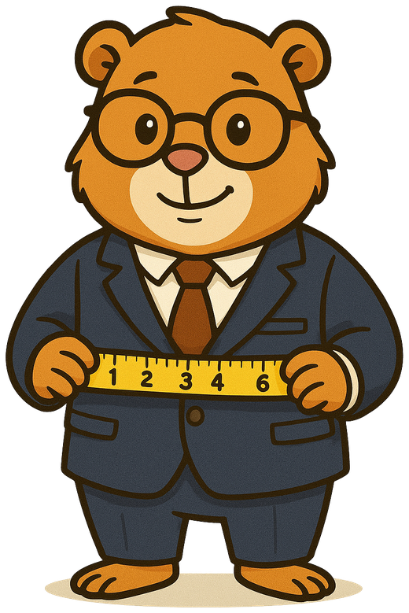

# Audit Notary

**Bootstrap.** The concepts, specifications and decisions are written; the web app, its mock server, its end-to-end
suite and the application with its login, configuration and repository handling are built. The document operations
follow.

## What is it?

Security documentation tends to live in four places at once: a spreadsheet for the OWASP SAMM assessment, a wiki page
per threat model, a Confluence space for incident reports and an ISMS tool. Each has its own history, its own rights and
its own backup, and none of them knows the others.

**Audit Notary** is the server application in which a development organisation keeps its
**OWASP SAMM assessments, threat models, incident response reports and ISMS documents** as versioned documents on the
**Git server it already runs**. No client holds a clone and no additional database is needed.

It is designed with two interfaces: a **web app** for people (built) and an **MCP server** for AI agents acting for a
user (planned). It is built on
the libraries of [`git-document-repository`](https://github.com/cuioss/git-document-repository) and on
[Token Sheriff](https://github.com/cuioss/TokenSheriff), and runs as a Quarkus native application on Java 25.

## How it works

Git is the record. Every change to a document is a commit, so the history of an assessment or a report, with who
changed what and when, is the history of the Git server and not a table in a database of its own. The categories share one shape: a schema per kind of document, YAML data with AsciiDoc free text, generated
output, review and approval, deadlines and typed links. By design both interfaces call the same application services,
so what a user may do is decided once, in the server.

The reasoning is in the [Overview](doc/concepts/audit-notary-overview.adoc), the
[SAMM concept](doc/concepts/category-samm.adoc) and
[Authentication and Identity](doc/concepts/authentication-and-identity.adoc).

## Project state

Audit Notary is in its bootstrap. The web app, its mock server, the end-to-end suite and the Quarkus application with the
web login, the configuration and the repository handling exist, and the native image runs against Keycloak in CI. The
document operations of the four categories, the MCP server and the directory follow, in the order of
[Architecture and Modules](doc/specification/architecture-and-modules.adoc).

## Documentation

- [Documentation index](doc/README.adoc): concepts, decisions and specification.
- [Overview](doc/concepts/audit-notary-overview.adoc): the place to start.
- [Specification](doc/README.adoc#_specification): the requirements (`AUN-...`) with their design.
- [Decisions](doc/README.adoc#_decisions): the architecture decision records.
- [Development](doc/development/README.adoc): modules, build, tests, CI and releasing.

## License

Audit Notary is licensed under the [Functional Source License, Version 1.1, ALv2 Future License
(FSL-1.1-ALv2)](LICENSE.md): each version becomes available under the Apache License 2.0 two years after it is made
available. The mascot illustrations are AI-generated and keep their own terms (Apache License 2.0); their origin is in
[Image Provenance and Licensing](doc/resources/brand/image-provenance.adoc).

For organizations that cannot comply with the FSL's competing-use restriction during the licensed period (e.g.,
proprietary or closed-source deployments that compete with the software), commercial licenses are available.
[Request a commercial license](https://tally.so/r/9qalQY) through the private licensing form (no public issue is
created).
