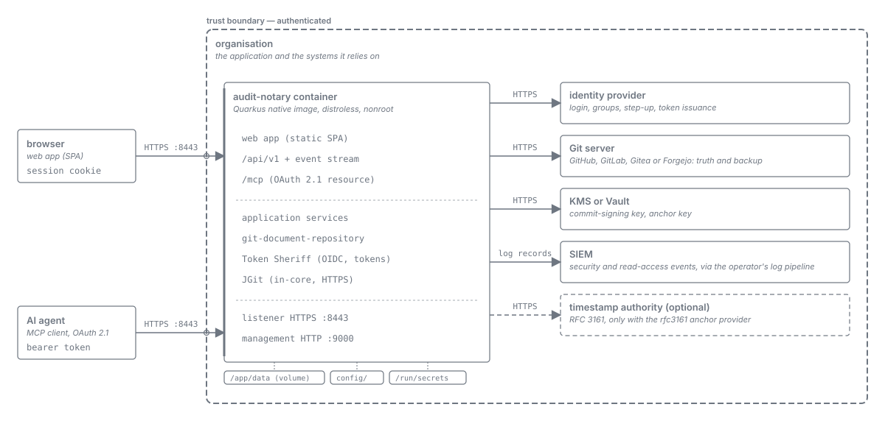

= Deployment
:toc: left
:toclevels: 3
:toc-title: Table of Contents
:sectnums:
:source-highlighter: highlight.js

xref:../README.adoc[Audit Notary documentation] » Concepts

Audit Notary needs no new database. An operator runs one container with one persistent volume, sets a few
environment variables and provides the secrets listed under <<_configuration_and_secrets>>, and connects a few systems
the organisation already runs. This page
names all of them, and how the container is built and shipped. The structure
follows API Sheriff.

== What Runs Where

[cols="1,3"]
|===
|Component |Role

|*Audit Notary container*
|The native binary: web app, REST API, MCP endpoint, services. Listens on HTTPS; management (health, metrics) on a
separate port.

|*Persistent volume*
|The local repositories, a cache that can be deleted and fetched again, and the drafts. Without it a restart loses
every unsaved draft.

|*Git server* (GitHub, GitLab, Gitea, Forgejo)
|Source of truth and backup, the configuration repository included; protected branches and tags.

|*Identity provider*
|Authentication of people and agents; groups; step-up. The Token Sheriff libraries that talk to it run inside the
application.

|*KMS or Vault*
|Preferably the commit-signing key and the anchor key. With the anchor key the application signs its own timestamps,
which anchor the releases and the periodic checkpoints.

|*SIEM*
|Read-access and security events of the application.
|===

Every repository has a remote. For an evaluation on one server the remote can be a local bare repository outside the
volume, on storage that survives a replacement of the container and is included in the backups. The code path is the
same, and a Git server can take over later with one push.

== The Image

Following API Sheriff, the image holds the native binary on a digest-pinned distroless base, runs as `nonroot`, and
is published for amd64 and arm64 as `ghcr.io/cuioss/audit-notary`
(xref:../specification/deployment.adoc#AUN-OPS-1[AUN-OPS-1]). The binary answers the health check itself
(`--health-probe`), because the distroless image has no shell or other programs to run a check with: it is built
from `gcr.io/distroless/cc`
(https://github.com/quarkusio/quarkus-images/blob/95188c0a6a1760b9b5766516c7fc7748e7485aaf/quarkus-distroless-base-image/src/main/java/io/quarkus/images/QuarkusDistroless.java[`QuarkusDistroless.java`]),
and distroless images contain no package managers, shells or other programs
(https://github.com/GoogleContainerTools/distroless[distroless README]).

The release follows the cuioss release process of the application repository; publishing the image is part of it.

[#_configuration_and_secrets]
== Configuration and Secrets

The container gets only what it cannot start without, as environment variables (`AUDIT_NOTARY_*`) or system
properties: the login with the group of the configuration administrators, the application's origin, the remote of the
configuration repository with the Git credential, and the secrets and trust anchors
(xref:../specification/configuration.adoc#AUN-CONF-3[Configuration, AUN-CONF-3]). Everything else, from the list of
repositories to the rights and the categories, is in the configuration repository, which the administrators change in
the web app and the application applies without a restart
(xref:../adr/0006-The_configuration_lives_in_a_configuration_repository_written_by_the_application.adoc[ADR-0006]).
Secrets (the Git credential of the technical user, the TLS key, the OIDC client credential) are mounted files or Vault
references; the commit-signing key
and the anchor key are best kept in a KMS
(https://github.com/cuioss/git-document-repository/blob/main/doc/concepts/identity-and-signing.adoc#_what_has_to_be_done_right[Identity and Signing]). The full list is
in xref:../specification/deployment.adoc#_secrets[Deployment,
Secrets].

== Compose Sample

The `deployment` module carries a compose sample, like API Sheriff's, that runs the published image and never builds
one:

* `audit-notary` on `${AUDIT_NOTARY_IMAGE}` with a named volume and its service-level settings;
* Keycloak as identity provider with a realm for people (web login) and a client registration for an MCP client;
* Gitea as Git server with the configuration repository and the repositories of the default cut;
* start and stop scripts and a check script that logs in, saves a draft and releases it.

The integration tests use the same topology with additional variants.

[#_operating_duties]
== Operating Duties

. The Git server's backup covers every saved state. Drafts are never pushed; they stay on the volume: back the volume
  up as well, otherwise losing it loses them
  (https://github.com/cuioss/git-document-repository/blob/main/doc/concepts/storage-engine.adoc#_two_levels_of_saving[Storage Engine, Two Levels of Saving]).
. When the application lists a repository whose retention period has ended, delete the remote repository on the Git
  server, and let backups expire with the same period: deleting the repository in the application reaches neither.
. Create the configuration repository, and the remote repository of every alias the configuration administrators
  add, the incident repository of each new year included; the application creates no repository on the Git server
  (xref:../use-cases/10-operations.adoc#UC-OPS-2[UC-OPS-2]).
. Protect `main` of every repository on the Git server, the configuration repository included, so that only the
  technical user may push to it and nobody may force-push; the application cannot verify this setting
  (xref:authentication-and-identity.adoc#_the_git_credential[Authentication and Identity, The Git Credential]).
. Watch the readiness probe (xref:../specification/deployment.adoc#AUN-OPS-2[Deployment, AUN-OPS-2]).
. Register the commit-signing key with the bot account if the Git server shall show commits as "Verified".
. Route the application's security events into the SIEM.

== Open Questions

. Whether the first organisation needs an RFC 3161 timestamp authority instead of the own timestamp, and which one
  (qualified under eIDAS, or internal under another responsibility).
. Whether a Helm chart is shipped beside the compose sample.
. Sizing of the volume and memory for the expected number of repositories and documents (to be measured).

== Related

* xref:application-architecture.adoc[Application Architecture]
* xref:data-protection-and-repository-layout.adoc[Data Protection and Repository Layout] — the repository cut and the
  person directory
* https://github.com/cuioss/git-document-repository/blob/main/doc/concepts/evidence-and-companion-stores.adoc[Evidence and Companion Stores] — anchoring
