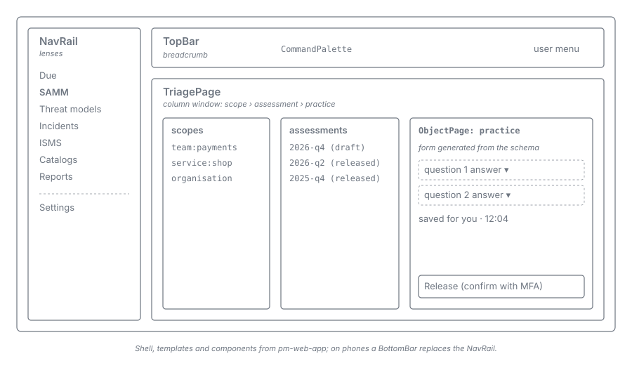

= Web App
:toc: left
:toclevels: 3
:toc-title: Table of Contents
:sectnums:
:source-highlighter: highlight.js

xref:../README.adoc[Audit Notary documentation] » Concepts

The web app is where a security officer releases an assessment and where a team spends a two-hour SAMM workshop. The
first needs to see exactly what is being approved; the second needs a form that keeps up with the discussion. The
cuioss project already has an interface vocabulary for such pages: the `pm-web-app` of `pm-mcp-clients`.
Audit Notary takes its visuals and its technical UI structure from there and changes only what the domain and the
authentication demand.

== What Is Taken Over

[cols="1,3"]
|===
|Part |From `pm-web-app`

|*Stack*
|Svelte 5 with runes, SvelteKit with `adapter-static` as a pure single-page app with a `fallback` page, Vite,
TypeScript in strict mode, ESLint, Prettier and stylelint.

|*Visual language*
|The token contract of `src/styles/tokens.css` — its names, a light and a dark palette, the
https://www.w3.org/TR/WCAG21/[WCAG 2.1] AA contrast checks of its theme-readability design — Inter self-hosted and the
rules of an own icon set; no raw colour literal in a view or a component. The values and the look are Audit Notary's
own (<<_visual_design>>).

|*Structure*
|The shell (`AppShell` with `NavRail`, `TopBar`, `BottomBar` on the phone, `CommandPalette`), the page templates
(`DashboardPage`, `ObjectPage`, `TriagePage`, `WizardPage`), the closed vocabulary of basic components, one address
model with one canonical route per object kind.

|*Plumbing*
|One `ApiClient` against same-origin `/api/v1` with one shared Server-Sent Events stream; the en/de message texts
from the server (`/api/v1/messages`); Vitest and Testing Library beside the code, Playwright and axe-core in a
separate module; `frontend-maven-plugin` builds a resource JAR the Quarkus application serves.
|===

The design documents of `pm-web-app` (`pm-mcp-clients/doc/design/web-app/`) are the reference for the visual and
interaction rules; this page records only the deviations.

=== Why a Static Single-Page Application

A form-heavy, live-updating workshop interface needs client state, so server-rendered pages (Qute) would not carry it
and would share nothing with `pm-web-app`. A separate frontend server would add a second process, a second origin and
CORS; served from the application's own origin, the session cookie can be `SameSite=Strict`. A component library
(Material, Tailwind UI) would break the closed vocabulary and the token contract of `pm-web-app`. The cost: parts of
`pm-web-app` are copied until a shared component package exists.

== Structure of the App

The rail carries the *lenses* of Audit Notary:

[cols="1,2,2"]
|===
|Lens |Chain of levels (columns) |Template

|*Due* (start page)
|launcher: deadlines, reviews, releases waiting for the user
|`DashboardPage`

|*SAMM*
|scope › assessment › practice
|`TriagePage`, the practice as `ObjectPage`

|*Threat models*
|service › threat model
|`TriagePage`

|*Incidents*
|year › incident
|`TriagePage`

|*ISMS*
|risks › entry; documents
|`TriagePage`

|*Catalogs*
|catalog › entry (roles, teams, services, systems, external parties)
|`TriagePage`

|*Reports*
|trends, comparisons, reporting dates
|`DashboardPage`

|*Settings*
|own directory entry
|`WizardPage`
|===

The first login and the release of a document run as `WizardPage` flows.

== What Differs

[#_visual_design]
=== Visual Design

The token names and the structure stay; the values and the look are Audit Notary's own: the register — a desk, sheets
with a register margin, the seal of a release, the daybook — with Source Serif 4 for the record beside Inter
(xref:visual-design.adoc[Visual Design: The Register]).

=== Authentication

`pm-web-app` pairs a device and sends a device secret as bearer token. Audit Notary does not: the browser never holds a
token. The server is the confidential client of the identity provider (Token Sheriff), keeps a server-side session and
gives the browser only cookies (xref:../specification/authentication.adoc#AUN-AUTH-1[Authentication, AUN-AUTH-1]).
State-changing requests carry an anti-CSRF header the `ApiClient` adds; the server also refuses them when their
`Origin` is another origin than its own. A `401` sends the user through the login and
back to the same address; a step-up demand opens the identity provider's multi-factor prompt and returns to the release
(xref:authentication-and-identity.adoc[Authentication and Identity]). With local users the login is a page of the app
itself, posted to Quarkus' form authentication (the one request without the anti-CSRF token, checked by its `Origin`
instead), and step-up, where switched on, a password dialog
(xref:authentication-and-identity.adoc#_local_users[Authentication and Identity, Local Users]). The session, the CSRF check and the session view
are designed against Token Sheriff's planned session layer
(xref:authentication-and-identity.adoc#_token_sheriffs_session_layer[Authentication and Identity, Token Sheriff's
Session Layer]).

=== Forms from Schemas

Every document is edited in a form generated from the category's JSON Schema: field types map to the field components,
`required` marks mandatory fields, enumerations become pickers, references to catalogs (`service:`, `team:`, `role:`)
become pickers over the catalog, a person field a picker over the person directory, and AsciiDoc fragments get a text
area with a preview that the server renders. The same schema validates in the browser and in the server; the server's
verdict wins. No category has a hand-written view.

The form is a kit of a few components, each with its own picture of what it holds and what it says when the value is
not clean: a retired catalog entry stays readable and is shown as retired, a person nobody has logged in as yet is
offered with that mark, an erased person reads as a former member with the team and role they had, a reference that
resolves to nothing says so. The same kit renders a document that is only read, a revision and a document as of a
date, so that what is read has the shape of what was edited. The constructs, the rules that choose a component and the
checks are in xref:../specification/web-app.adoc#AUN-WEB-4[AUN-WEB-4]; the requests are in
xref:../specification/rest-api.adoc#_form_kit_requests[REST API Register, Form Kit Requests].

=== Drafts, Saving and Conflicts

The form saves intermediate states automatically as drafts and shows "saved for you" versus "saved for everyone". The
`ApiClient` sends the blob id it loaded with every save; a concurrent change of the same file returns a conflict for
that file, and the draft is kept. The form shows the fields that differ, with both values, and the user decides. When
the Git server is unreachable, the save fails and the draft keeps the work. Changes by others arrive over the event
stream; a practice another assessor saved refreshes in place.

=== Review and Release

Release shows the diff against the last released state, generated from the YAML, not from the AsciiDoc output. A
control whose transition requires step-up, under the shipped workflows the release button, triggers the renewed
multi-factor login before the transition is written. The control names the domain act only ("Release"); a line in the
margin says, in domain words and whatever the method, that the user confirms their identity once more. A mechanism
(MFA, step-up, password) is never a label.

== Security of the Page

* A strict Content Security Policy without `unsafe-inline` for scripts; the SvelteKit bootstrap script is allowed by
  hash. With `kit.csp.mode` `'hash'` (or `'auto'`, which uses hashes for prerendered pages) SvelteKit adds the
  SHA-256 hash of every inline script it generates
  (link:https://svelte.dev/docs/kit/configuration#csp[SvelteKit configuration, `csp`]). The `adapter-static`
  fallback page is rendered as a prerendered page, so the policy is written into it as a
  `<meta http-equiv="content-security-policy">` tag
  (link:https://github.com/sveltejs/kit/blob/%40sveltejs/kit%403.2.0/packages/kit/src/core/postbuild/fallback.js[`fallback.js`],
  link:https://github.com/sveltejs/kit/blob/%40sveltejs/kit%403.2.0/packages/kit/src/runtime/server/page/render.js[`render.js`],
  `@sveltejs/kit` 3.2.0). A `<meta>` policy does not support `frame-ancestors`, `report-uri` and `sandbox`
  (link:https://www.w3.org/TR/CSP3/#meta-element[Content Security Policy Level 3, section 3.3]), so the Quarkus
  application also sends the full policy, `frame-ancestors` included, as a response header
  (xref:../specification/web-app.adoc#AUN-WEB-8[AUN-WEB-8]).
* No third-party origin: fonts, icons and scripts come from the application.
* AsciiDoc previews and generated reports are rendered by the server and sanitised; the browser never renders raw
  user HTML.
* Every text shown comes from the server's message texts or from validated document data.

== Open Questions

. Which `pm-web-app` components move into a shared component package instead of being copied.
. Which revision of the document a release request carries, so the release is bound to exactly the state the approver
  reviewed and refused with `CHANGED_SINCE_REVIEW` when the working branch has moved since
  (xref:../specification/web-app.adoc#AUN-WEB-6[AUN-WEB-6] names the outcome, not yet the request field).

Decided provisionally with the access use cases (UC-ACC-1, -2, -3, -6, -7), recorded with their reasons in
xref:../specification/rest-api.adoc#_open_questions[REST API Register, Open Questions]; the owner may change each one:

. Three pages outside the shell: `/login` (local users; with the identity provider it starts the login), `/signed-out`
  (the landing of every logout, in place of "the start page") and `/login-problem?reason=` (the provider cannot be
  reached, too many logins, an unknown login transaction). None is a valid `return` of a login.
. One step-up handler for every transition that asks (release, completion of a stage, save of the configuration,
  activation of a category): it reads how the confirmation works from the status, asks for the password in a dialog or
  leaves for the provider, and keeps no pending act across the redirect, so the user chooses the act again after the
  return (Token Sheriff's planned pending action, SESSION-8, replaces this).
. A session without rights is a session: a notice and empty states, never a login loop.
. A session that another login in the same browser replaced is recognised by its changed anti-CSRF token when the event
  stream closes, and the tab reloads.

Decided provisionally with the form kit (xref:../specification/web-app.adoc#AUN-WEB-4[AUN-WEB-4], recorded with the
bodies in xref:../specification/rest-api.adoc#_decided_forms[REST API Register, Open Questions]); the owner may change
each one:

. The form reads the schema of a whole category with one request, and takes every text from the message catalogue
  under `category.<category>.<kind>.field.<path>`, never from the schema.
. An ordered list of rules chooses the component of a property; what the requirement does not name (dates without time,
  numbers, lists of scalars, sections, a reference to a document, read-only fields) is added, and a construct the form
  does not know is shown as plain data and saved unchanged.
. The browser validates with its own small check and no validator library, so the dependency stays out; its `format`
  checks are advice and never stop a save, and the server's verdict replaces them.
. The server renders and sanitises the AsciiDoc preview, in the strictest safe mode of Asciidoctor, up to 64 KiB; the
  web app builds its elements from the answer by the same allow-list and renders no raw HTML.
. A person who has not logged in yet is offered and shown as *not yet bound*, an erased one as *former*, and a retired
  catalog entry as *retired*; the person list and a reference lookup are requests of their own.
. The pickers are built, decided provisionally (UI, `web-app/src/lib/forms/`): a catalog and a person are chosen from a
  list control (no combobox); a list of eight or more people, or one the server cut off at 100, adds a field that
  narrows it by name (with a cut-off list the server narrows it with `?q=`); the mark *not yet bound* is worded "Not yet
  bound" ("Noch nicht verknüpft"); a row is removed only after a confirmation; the first four scalar properties are the
  columns, and the minimum of a list hides the removal instead of disabling it with a reason on every row; the hints of
  a field, the one of a free text included, stay in the reading.

== Related

* xref:authentication-and-identity.adoc[Authentication and Identity]
* xref:application-architecture.adoc[Application Architecture]
* https://github.com/cuioss/git-document-repository/blob/main/doc/concepts/schema-driven-documents.adoc[Schema-Driven Documents] — schemas and generated output
* `pm-mcp-clients/pm-web-app` and `pm-mcp-clients/doc/design/web-app/` (reference implementation and design)
